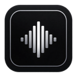

# Tishe

**Private memory for your conversations.** Диктовка и расшифровка длинных записей на русском — целиком на вашем компьютере, без интернета и без аккаунта.

[English version](README.en.md) · [Скачать](https://github.com/PereverzevVV/tishe/releases/latest) · [Что дальше](#что-дальше)

Tishe читается «тише» (по-английски TEE-sheh).

## Что умеет

- **Расшифровка файлов.** Перетащите аудио или видео любой длины — лекцию, интервью, созвон из Zoom или Телемоста. Получится документ Word или Markdown: текст по говорящим («Спикер 1», «Спикер 2»), с тайм-кодами, разбитый на части.
- **Разделение по говорящим** — встроенной моделью, без интернета.
- **Редактура встроенной нейросетью.** Исправляет ошибки распознавания и пунктуацию, убирает «э-э» и «ммм». Нейросеть работает на процессоре, скачивается по желанию. Можно приложить исходную расшифровку рядом с исправленной.
- **Очередь файлов.** Добавьте несколько записей — они расшифруются по очереди, пока вы заняты другим.
- **Диктовка** в любую программу по горячей клавише: Word, браузер, мессенджер.
- **Модели на выбор:** GigaAM v3 для русского, NVIDIA Parakeet для английского и европейских языков, Qwen3-ASR и Whisper для остальных. Первый запуск спрашивает язык ваших записей и предлагает подходящую модель.
- **Без облака.** Звук и текст не покидают компьютер. Облачные сервисы (OpenAI, Groq и др.) можно подключить своим ключом, но по умолчанию они выключены.

## Цифры

Замеры на ноутбуке с Ryzen 5 7530U и 16 ГБ памяти, без дискретной видеокарты, Windows 11. Одна запись на язык, один повтор; WER — доля ошибок в словах против ручного эталона, меньше — лучше.

| Запись                       | Как расшифровано                      | Время   | WER   |
| ---------------------------- | ------------------------------------- | ------- | ----- |
| Встреча на русском, 24 мин   | GigaAM v3, с разделением по говорящим | 2,2 мин | 8,9 % |
| то же                        | GigaAM v3 + редактура Gemma 4 E2B     | 6,7 мин | 8,4 % |
| Подкаст на английском, 8 мин | Parakeet TDT 0.6B v2                  | 1,0 мин | 1,0 % |

Час записи на русском с говорящими и редактурой — примерно 17 минут на таком ноутбуке (оценка по замеру выше). Замер на слабом ноутбуке с GeForce MX150 будет в следующем выпуске.

Сравнение моделей на русской встрече (28 мин, без редактуры):

| Модель                                    | WER       | Время   |
| ----------------------------------------- | --------- | ------- |
| **GigaAM v3** (по умолчанию для русского) | **7,1 %** | 1,6 мин |
| Parakeet Ultra 0.6B                       | 11,0 %    | 2,2 мин |

Qwen3-ASR 1.7B на другой русской встрече (24 мин) ошибается вдвое чаще GigaAM (около 19 %) и работает в 4 раза медленнее.

Подробности, методика и все прогоны — в [DOCUMENTATION.md](../DOCUMENTATION.md), раздел 9.

## Установка

1. Скачайте `Tishe_…_x64-setup.exe` со [страницы выпуска](https://github.com/PereverzevVV/tishe/releases/latest).
2. Запустите. Установщик не подписан платным сертификатом, поэтому Windows покажет синее окно «Система Windows защитила ваш компьютер». Нажмите **«Подробнее»**, затем **«Выполнить в любом случае»**.
3. При первом запуске выберите язык записей — Tishe скачает модель распознавания (от 0,3 до 1,6 ГБ).

Требования: Windows 10 или 11 (64 бит), процессор с AVX2 (почти все с 2013 года). Проверено на 16 ГБ памяти; на 8 ГБ пока не проверяли. ffmpeg для чтения аудио и видео уже внутри установщика.

Что Tishe отправляет в интернет: только скачивание моделей (Hugging Face и зеркало Handy) и раз при запуске вопрос GitHub о новой версии (выключается в «Приложение» → «Обновления»). Записи и тексты не отправляются никуда, если вы сами не подключили облачный сервис.

## Что дальше

Tishe — первая часть Private Memory: личной памяти разговоров, которая живёт на вашем компьютере. Следующие версии, по порядку:

1. **Запись встреч** — ваш микрофон и собеседники двумя дорожками, текст по ходу разговора.
2. **Итоги встречи** — решения и задачи сразу после остановки, на языке встречи.
3. **Поиск по встречам** — сначала по словам, потом по смыслу.
4. **Заметки и ассистенты** — папка встречи для Obsidian, доступ AI-ассистентов к встречам по MCP.

Сроков не обещаю: порядок может измениться по отзывам. Поставьте звезду, чтобы следить, и пишите в [Issues](https://github.com/PereverzevVV/tishe/issues), чего не хватает.

## Как сделан проект

Tishe основан на [Handy](https://github.com/cjpais/Handy) — открытой программе для диктовки от CJ Pais. Из Handy пришли диктовка, движки распознавания и менеджер моделей; Tishe добавил расшифровку файлов, говорящих, встроенную нейросеть и свой интерфейс. Спасибо CJ Pais и всем участникам Handy.

Код написан с Claude Code. Я спроектировал продукт, ставил задачи, собрал стенд для сравнения моделей на своих эталонных записях и принимал решения по замерам.

Сборка из исходников и устройство программы — в [DOCUMENTATION.md](../DOCUMENTATION.md) (разделы 4 и 8), история изменений — в [CHANGELOG.md](../CHANGELOG.md).

## Лицензия

[MIT](../LICENSE), как и у Handy. Ядро бесплатное и останется бесплатным; в будущем возможны платные расширения. Лицензии сторонних библиотек и моделей — в [THIRD_PARTY_NOTICES.txt](../src-tauri/licenses/THIRD_PARTY_NOTICES.txt) и в программе: «О программе» → «Лицензии».

## Автор

Разработчик — Виктор Переверзев (Viktor Pereverzev), финансовый аналитик. [Профиль на GitHub](https://github.com/PereverzevVV).
